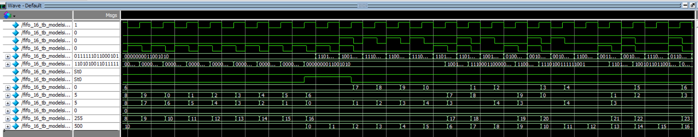
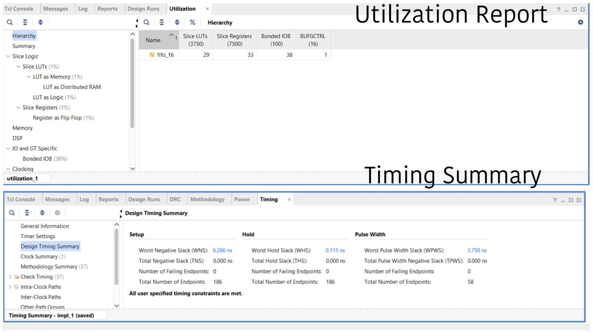
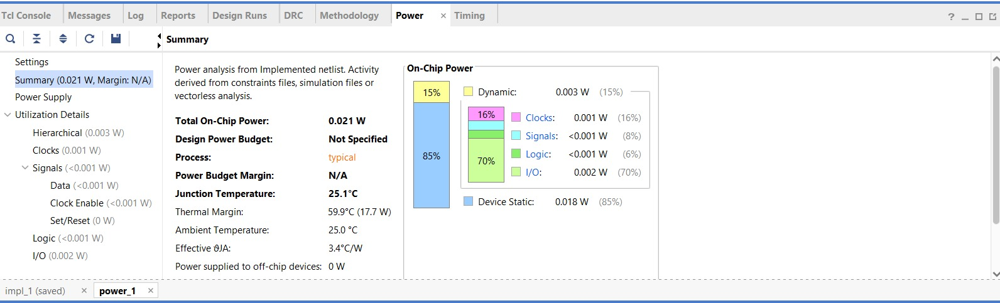

# Parameterized Synchronous FIFO RTL Design & Verification

## 1. Project Overview

This project implements a parameterized synchronous First-In, First-Out (FIFO) buffer using Verilog RTL. It supports configurable data width and depth, read and write operations, occupancy tracking, full and empty detection, and simultaneous read/write operation.

The project covers RTL development, self-checking functional verification, waveform-based debugging, and FPGA implementation analysis.

## 2. Design Features

- Parameterized data width and FIFO depth
- Synchronous reset and clocked read/write control
- Read and write pointer management
- Occupancy counting using a count register
- Full and empty flag generation
- Protection against writes when full and reads when empty
- Simultaneous read/write handling
- Explicit pointer wrap-around for non-power-of-two FIFO depths

## 3. Verification Methodology

A self-checking testbench was developed using a reference-model scoreboard to compare expected FIFO behavior against the simulated output.

Verification scenarios included:

- Reset and initial empty-state checks
- Normal write and read operations
- Read attempts when empty
- Write attempts when full
- Simultaneous read/write operations
- Directed, corner-case, and random testing
- Waveform analysis and pointer wrap-around debugging

### Debugging Highlight

During testing with `DEPTH = 10`, `$clog2(DEPTH)` provided enough bits to represent the pointer, but it did not automatically constrain the pointer to valid memory indices from 0 to 9.

Explicit pointer wrap-around logic was required to return the pointer to zero after reaching `DEPTH - 1`. This resolved invalid memory accesses that had produced unknown (`X`) values during simulation.

## 4. Simulation Evidence

The following waveform screenshot documents the FIFO simulation.

## 5. FPGA Implementation Results

The design was synthesized and implemented using Xilinx Vivado for a Spartan-7 FPGA target.

| Metric | Result |
|---|---:|
| Target | Spartan-7 |
| Clock constraint | 10 ns (100 MHz) |
| Slice LUTs | 29 |
| Slice registers | 33 |
| Worst Negative Slack (WNS) | +6.286 ns |
| Worst Hold Slack (WHS) | +0.115 ns |
| Total Negative Slack (TNS) | 0 ns |
| Total Hold Slack (THS) | 0 ns |
| Failing timing endpoints | 0 |

### Utilization and Timing Reports

## 6. Estimated Power Analysis

Vivado reported the following estimated on-chip power:

| Metric | Result |
|---|---:|
| Total on-chip power | 21 mW |
| Dynamic power | 3 mW |
| Device static power | 18 mW |

*These values are tool estimates based on the implementation and analysis assumptions, not measurements of physical FPGA board power.*

## 7. Tools Used

- Verilog RTL
- SystemVerilog testbench
- ModelSim Intel FPGA Edition
- Xilinx Vivado
- Spartan-7 FPGA target

## 8. Key Learnings

- Parameterized RTL design and reusable hardware description
- FIFO pointer and occupancy management
- Full/empty protection and simultaneous operations
- Self-checking verification using a reference model
- Waveform-based debugging of non-power-of-two depths
- FPGA resource utilization, timing, and power analysis

## 9. Future Improvements

- Add assertions for FIFO protocol and status checks
- Extend verification across additional parameter combinations
- Explore dual-clock FIFO design and clock-domain crossing
- Compare alternative FIFO pointer and control architectures

## Author

ECE Undergraduate Student | Interests: VLSI Design, RTL Verification, and Chip Design

## Running the Simulation

1. Open ModelSim Intel FPGA Edition.
2. Create or open a project containing fifo_16.v and fifo_16_tb.sv.
3. Compile both files.
4. Simulate the testbench module.
5. Inspect the waveform and testbench messages.
